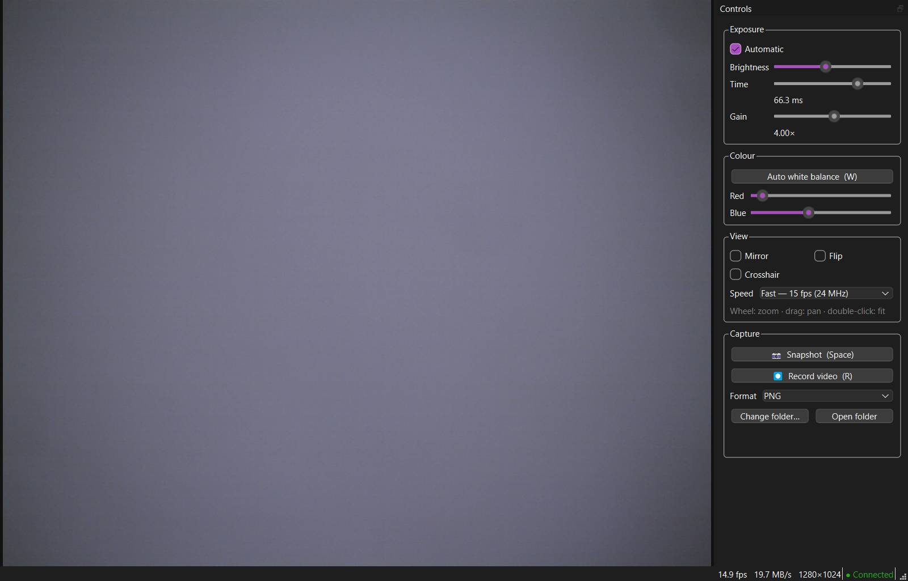

# Microscope Camera

**Make old HDCE-10A USB microscope cameras work on 64-bit Windows 10 and 11.**

Many labs still have the HDCE-10A digital microscope camera (sold with "ScopePhoto" / "EDn-2"
software; USB ID `1578:800C`, "Huaqi Digital"). Its original driver is 32-bit only, so on any
64-bit Windows the camera shows up as an unknown device and can't be used. This project replaces
the vendor software with a free, open-source driver package and viewer app.



## Download and install

1. Download **`MicroscopeCamera-Setup-x.y.z.exe`** from the
   [latest release](https://github.com/Baraa-Melhem/microscope-camera/releases/latest).
2. Run it and accept the administrator prompt. It installs the app and the USB driver.
   - If Windows shows *"Windows protected your PC"*, click **More info → Run anyway**.
     The installer isn't commercially code-signed.
3. Plug in the camera and start **Microscope Camera** from the Desktop or Start menu.

No Python, Zadig or vendor CD needed. Uninstall from *Settings → Apps*; that removes the driver too.

## Features

- Live colour video at **1280 × 1024, 15 fps** (8 fps "Safe" mode for slow USB ports or hubs)
- Automatic exposure, or manual exposure time and gain
- One-click white balance; manual red and blue
- Snapshots as PNG, TIFF or JPG, and MP4 video recording
- Zoom with the mouse wheel, drag to pan, crosshair overlay, mirror and flip
- Keyboard: `Space` snapshot · `R` record · `W` white balance · `F11` full screen
- Reconnects by itself if the camera is unplugged

## Supported hardware

| | |
|---|---|
| Camera | HDCE-10A and other cameras with the same internals |
| USB ID | `VID_1578 & PID_800C` |
| Bridge chip | eMPIA EM2750 (chip ID `0x21`) |
| Sensor | Micron/Aptina MT9M001, 1.3 MP colour (I2C `0x5D`, ID `0x8431`) |
| Windows | 10 and 11, 64-bit (x64) |

Cameras with a different USB ID but the same EM2750 + MT9M001 internals will probably work after
adding their ID to `driver/microscope_camera.inf` and `camera.py`. Pull requests are welcome.

## How it works

The vendor's kernel driver can't load on 64-bit Windows, so this project doesn't use it:

- **Driver**: the camera is bound to the generic, signed
  [libusb-win32](https://github.com/mcuee/libusb-win32) kernel driver. Windows only installs
  driver packages with a signed catalog, so the build signs the package catalog with a fresh
  self-signed certificate and **deletes its private key immediately** (the same approach as
  Zadig/libwdi). The installer trusts that certificate machine-wide; nobody can sign anything
  else with it.
- **User-space driver** (`camera.py`, `em28xx.py`, `lusb0.py`): it configures the EM2750 bridge
  and the MT9M001 sensor over USB control transfers and I2C, then rebuilds raw RGGB Bayer frames
  from the isochronous video stream.
- **App** (`microscope_viewer.py`): a PySide6 viewer with demosaicing, auto exposure, white
  balance and capture.

[docs/PROTOCOL.md](docs/PROTOCOL.md) records the hardware details found while reverse-engineering
the camera. Several of them aren't documented anywhere else.

## Running from source

Requires Python 3.10+ on 64-bit Windows, with the camera already bound to libusb-win32 (install
the release once, or use [Zadig](https://zadig.akeo.ie/) → libusb-win32).

```bash
pip install -r requirements.txt
python microscope_viewer.py
```

Diagnostics: `python probe.py` (USB descriptors, bridge registers) and `python i2cscan.py`
(sensor and EEPROM).

## Building the installer

Needs [Inno Setup 6](https://jrsoftware.org/isinfo.php) and a build venv:

```bash
python -m venv %LOCALAPPDATA%\mcb
%LOCALAPPDATA%\mcb\Scripts\pip install -r requirements-build.txt
powershell -ExecutionPolicy Bypass -File packaging\build.ps1
```

The output is `packaging\output\MicroscopeCamera-Setup-<version>.exe`. The version comes from
`VERSION` in `microscope_viewer.py`. Each build signs the driver with a new certificate.

## Credits

- Bridge and sensor initialisation follow the Linux kernel
  [em28xx driver](https://github.com/torvalds/linux/tree/master/drivers/media/usb/em28xx).
- [libusb-win32](https://github.com/mcuee/libusb-win32) provides the kernel driver.
- Built with PySide6 (Qt), OpenCV, NumPy, PyInstaller and Inno Setup. See
  [THIRD-PARTY.txt](packaging/THIRD-PARTY.txt).

## License

[GPL-3.0-or-later](LICENSE). The bundled libusb-win32 driver is GPL-3.0 and its library is LGPL-3.0.

Not affiliated with the camera's manufacturer. Use at your own risk.
